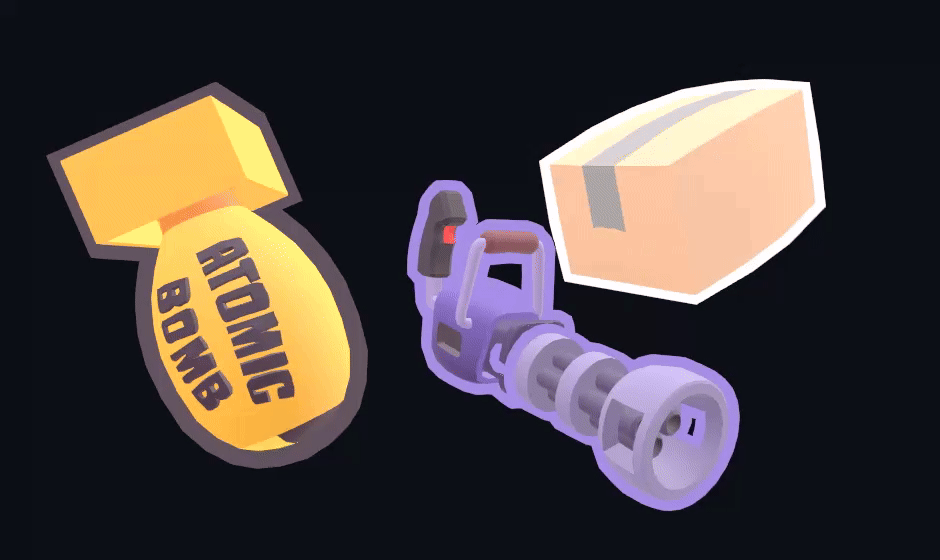

### About MeshOutline

Constant-width outlines for any mesh, skinned mesh or whole hierarchy in Unity. Add one component and toggle it with `enabled`: nothing runs per frame.

Outline meshes are baked in the editor into a shared cache, one per source mesh, and drawn by ordinary hidden renderers with a stencil mask and a smoothed-normal extrusion. There is no `Update()` loop, no post-processing, no render texture and no camera setup. Every mesh under an outline merges into one silhouette, and overlapping outlines resolve per pixel by depth.

It is built for production: duplicates, undo, prefabs, play mode and domain reloads never leave stale or shared copies behind, static batching and LOD groups keep their outlines, and builds bake anything still missing without touching your assets. Invalid input is rejected, every problem is reported once with its fix, and it runs in URP and Built-in on Unity 2022.3 and Unity 6.



### Features

1. Zero per-frame CPU cost
2. One silhouette per hierarchy
3. Overlaps resolved per pixel
4. Screen or world-space width modes
5. Skinned meshes and blend shapes
6. LOD groups and static batching
7. Undo, prefab and play mode safe
8. Shared, ahead-of-time mesh bakes
9. Build-time bake safety net
10. X-ray occlusion and HDR glow
11. URP and Built-in, VR ready

Detailed about features - see [FEATURES.md](Documentation/FEATURES.md). How the package is tested - see [TESTING.md](Documentation/TESTING.md).

### Performance

**Nothing runs per frame.** Showing or hiding an outline costs about 2 µs and changing its color 0.5 µs, both without allocating. On the GPU, an outline is two unlit draw calls per outlined renderer, with no extra render targets and no full-screen passes, so its cost follows the outlined geometry rather than the screen resolution.

**The rest is paid once, ahead of time.** Outline meshes are baked in the editor and shared, so building an outline when its object loads costs about 0.1 ms. Outlines added at runtime bake on the spot, in about 2 ms for a 10,000-vertex mesh. Measured in the Unity 2022.3 editor on an Intel Core i7-12700K.

Detailed about performance - see [PERFORMANCE.md](Documentation/PERFORMANCE.md).

### Requirements

1. Unity 2022.3 LTS or newer, including Unity 6.
2. URP or the Built-in Render Pipeline.
3. A depth buffer with stencil, the default 24 or 32 bits.
4. Mono or IL2CPP scripting backend.
5. No package dependencies.

### Limitations

1. HDRP, sprites and UI aren't supported.
2. Runtime bakes need Read/Write meshes.
3. Cloth and CPU-deformed meshes aren't followed.
4. Flat quads facing the camera get no outline.
5. Hard edges get slightly thinner outlines.
6. No motion vectors, so TAA can smear outlines.
7. Over 240 enabled outlines share stencils.
8. Edit mode only outlines LOD0.

### How to install

1. **Git URL.** In Unity, open **Window ▸ Package Manager ▸ + ▸ Add package from git URL…** and enter `https://github.com/reromanlee/MeshOutline.git?path=/UnityPackage#1.0.0`. Drop `#1.0.0` to track the latest `main` instead of a release.
2. **Manifest.** Add the same URL to `Packages/manifest.json`:

   ```json
   {
     "dependencies": {
       "com.reromanlee.meshoutline": "https://github.com/reromanlee/MeshOutline.git?path=/UnityPackage#1.0.0"
     }
   }
   ```

3. **Tarball.** Download `com.reromanlee.meshoutline-1.0.0.tgz` from the [latest release](https://github.com/reromanlee/MeshOutline/releases/latest), then choose **+ ▸ Add package from tarball…** in the Package Manager.

The **Hover & Select** sample can then be imported from the package's **Samples** tab in the Package Manager.

### How to use

**Add Component ▸ Rendering ▸ Object Outline** on any GameObject with a mesh, or on a model's root to outline every mesh under it as one shape. It's baked right away, in the scene or on the prefab. Show and hide it with `enabled`, which allocates nothing and rebuilds nothing:

```csharp
using reromanlee.MeshOutline;

[SerializeField] private ObjectOutline outline;

void OnHoverEnter() => outline.enabled = true;
void OnHoverExit() => outline.enabled = false;
```

**Change its look from code at any time.** Every setter applies immediately, and width is in pixels at 1080p by default, so an outline keeps its thickness at any distance and its share of the screen at any resolution.

```csharp
outline.Color = Color.cyan;
outline.Width = 6f;
outline.WidthMode = OutlineWidthMode.ScalesWithDistance;
outline.Occlusion = OutlineOcclusion.XRay;
outline.SetExcluded(muzzleFlash, true);
```

**Tell it when renderers change at runtime.** To cost nothing per frame, an outline copies renderers' enabled state, layers and blend-shape weights when it's enabled and on `Refresh()`; turn on **Track Source Every Frame** for facial animation. Commit the `Assets/MeshOutline Data/Baked Meshes/` folder: scenes and prefabs reference the meshes in it.

Detailed about usage - see [USAGE.md](Documentation/USAGE.md).

### License

Made by Roman Likhadievski (reromanlee.com).

Licensed under MIT - see [LICENSE.md](LICENSE.md).
